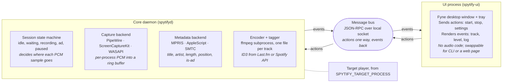
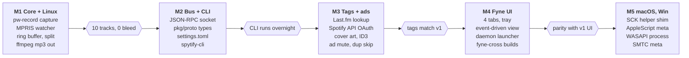

# Spytify v2 (Go) — Architecture & UI Plan

2026-10-23 · JW

> Markdown export of the shared planning doc. The three drawings of the original are redrawn below as Mermaid diagrams and an ASCII mock-up. The alpha built from this plan is described in [README.md](README.md); the choices made where the plan left a question open are listed at the end, under [Alpha implementation notes](#alpha-implementation-notes).

## Goals and non-goals

v2 is a rewrite in Go that records whatever player process is named in an environment variable, splits tracks sample-accurately, and runs on Linux, macOS and Windows from one codebase. The UI never touches audio: it only sends user actions as messages and renders events the core sends back.

**Goals**

- No player name hard-coded anywhere in the source. The target comes from `SPYTIFY_TARGET_PROCESS` (and `SPYTIFY_TARGET_MPRIS` / `SPYTIFY_TARGET_BUNDLE_ID` for the metadata backends).
- Core and UI are separate processes; every user action is a message, so a CLI, a tray app, a web page or a test harness can drive the same core.
- Keep the v1 settings people rely on (output folder, format, bitrate, naming, ads muting, API tags, silence trimming, min length, duplicate skip).
- Fix the track-boundary bug (v1 issue #359) by cutting at a computed sample index, not at the moment a window title changes.
- Single static binary per platform; ffmpeg is the only external runtime dependency.

**Non-goals**

- Downloading from Spotify Connect or the Spotify API (that is DownOnSpot territory and risks the account).
- A virtual audio cable driver. Per-process capture on each OS makes it unnecessary.
- Lossless output claims. Source is 160/320 kbps Ogg; FLAC/WAV are offered to avoid a second lossy pass, not to add quality.

## Process architecture

Two processes talk over one local message bus. The UI pushes actions and renders events; the core daemon does all capture, splitting, encoding and tagging, and keeps running if the window is closed.



*The UI only sends messages; the core owns audio, metadata and encoding.*

Actions flow left to right and events flow back; the core never calls into the UI, so any client that speaks the bus protocol (CLI, tray app, web page, test harness) can drive it.

**Why a bus instead of one process**

- The headless overnight use case needs no window at all: `spytifyd` runs alone, `spytify-ui` attaches later.
- Fyne (or any GUI toolkit) must own the main thread on macOS; keeping it out of the core avoids the audio thread fighting the UI loop.
- Every user action is already a serialised message, so recording a session for a bug report or replaying one in tests is free.

**Transport**

- Linux and macOS: Unix domain socket at `$XDG_RUNTIME_DIR/spytify.sock` (macOS: `~/Library/Application Support/Spytify/spytify.sock`).
- Windows: named pipe `\\.\pipe\spytify`.
- Framing: newline-delimited JSON-RPC 2.0. Actions are requests with a result; events are notifications (no id). Standard library `net` + `encoding/json`, no third-party RPC framework.
- Optional `--listen 127.0.0.1:7811` flag exposes the same protocol over TCP for a web UI; off by default.

## Configuration

The player is never named in source. Three environment variables identify it per backend, read once at daemon start; everything else lives in a TOML settings file that the UI edits through the bus.

| Variable | Used by | Default if unset | Example |
| --- | --- | --- | --- |
| `SPYTIFY_TARGET_PROCESS` | Capture backend (process name match) | none, daemon refuses to start | `spotify` on Linux, `Spotify` on macOS, `Spotify.exe` on Windows |
| `SPYTIFY_TARGET_MPRIS` | Linux metadata (D-Bus bus name) | `org.mpris.MediaPlayer2.` + process name | `org.mpris.MediaPlayer2.spotify` |
| `SPYTIFY_TARGET_BUNDLE_ID` | macOS metadata and capture (bundle id) | none | `com.spotify.client` |
| `SPYTIFY_CONFIG` | Core | OS config dir + `/spytify/config.toml` | `~/.config/spytify/config.toml` |
| `SPYTIFY_SOCKET` | Core and UI | OS runtime dir + `/spytify.sock` | `/run/user/1000/spytify.sock` |
| `SPYTIFY_FFMPEG` | Encoder | `ffmpeg` found on `PATH` | `/opt/homebrew/bin/ffmpeg` |

Rules:

- `internal/target` is the only package that reads these variables. It exposes a `Target{ProcessName, MPRISName, BundleID}` struct; backends receive the struct, never the env.
- A `.env` file next to the binary is loaded if present (`github.com/joho/godotenv`), so the prototype ships with an `.env.example` and no player name in git.
- Settings changes from the UI go through the `settings.set` action, are validated by the core, written to `config.toml`, then broadcast as a `settings.changed` event so every connected client stays in sync.
- The daemon logs the resolved target at startup (`target process=spotify mpris=org.mpris.MediaPlayer2.spotify`) so a misconfigured env is obvious in the first line.

## Settings carried over from v1

Every v1 option that still makes sense is kept, grouped under the same tabs users know. Two Windows-only options are dropped (virtual audio cable, audio endpoint picker) because capture is per-process now; one is new (output format, since the encoder is ffmpeg).

| Tab | Setting | TOML key | Type / values | Default |
| --- | --- | --- | --- | --- |
| Recorder | Output folder | `output.dir` | path | `~/Music/Spytify` |
| Recorder | Group by folders | `output.group_by` | `none`, `artist`, `artist/album` | `artist/album` |
| Recorder | Track number in file name | `output.number_prefix` | bool | false |
| Recorder | Add separators (`_` instead of spaces) | `output.underscores` | bool | false |
| Recorder | File name template | `output.template` | string, `{artist}`, `{title}`, `{album}`, `{track}`, `{year}` | `{artist} - {title}` |
| Recorder | Output format | `encode.format` | `mp3`, `aac`, `flac`, `wav` | `mp3` |
| Recorder | Bitrate | `encode.bitrate_kbps` | 128, 160, 256, 320 (ignored for flac/wav) | 160 |
| Recorder | Minimum track length | `recorder.min_seconds` | int seconds | 30 |
| Recorder | Skip already recorded tracks | `recorder.skip_duplicates` | bool | true |
| Recorder | Record a single track then stop | `recorder.single_track` | bool | false |
| Recorder | Record over duplicate (replace) | `recorder.overwrite` | bool | false |
| Recorder | Trim leading/trailing silence | `recorder.trim_silence` | bool | true |
| Recorder | Silence threshold | `recorder.silence_db` | dBFS | -50 |
| Recorder | Boundary search window | `recorder.boundary_window_ms` | int ms | 300 |
| Advanced | Mute ads | `ads.mute` | bool | true |
| Advanced | Record ads to separate folder | `ads.record` | bool | false |
| Advanced | Mute target player output (listen elsewhere) | `player.mute_output` | bool | false |
| Advanced | Normalize volume | `recorder.normalize` | bool | true |
| Advanced | Target loudness | `recorder.target_lufs` | float | -14 |
| Advanced | Pause player when disk is full | `recorder.pause_on_disk_full` | bool | true |
| Tags | Media tags source | `tags.source` | `lastfm`, `spotify_api`, `none` | `lastfm` |
| Tags | Spotify client id | `tags.spotify.client_id` | string | empty |
| Tags | Spotify client secret | `tags.spotify.client_secret` | string, stored in OS keyring | empty |
| Tags | Spotify redirect URI | `tags.spotify.redirect_uri` | string | `http://127.0.0.1:7812/callback` |
| Tags | Last.fm API key | tags.lastfm.api_key | string, stored in OS keyring | built-in app key, as v1 ships; user key overrides |
| Tags | Last.fm shared secret | tags.lastfm.secret | string, stored in OS keyring | built-in; only needed for signed calls |
| Recorder | Session timer (stop after) | recorder.session_timer | duration, 0 = off | 0 |
| Recorder | Counter start value | output.counter_start | int | 1 |
| Advanced | Record everything (podcasts, unmute ads) | recorder.record_everything | bool | false |
| Tags | Replace track number with counter | tags.track_from_counter | bool | false |
| Tags | Move parenthesised extra title to subtitle | tags.extra_to_subtitle | bool | false |
| Tags | Embed album cover | `tags.cover` | bool | true |
| Tags | Cover size | `tags.cover_size` | `small`, `medium`, `large` | `medium` |
| Tags | Re-tag existing files | `tags.update_existing` | bool | false |
| Tags | Multiple artists separator | `tags.artist_separator` | string | `, ` |
| App | Language | `app.language` | BCP-47 code | system |
| App | Minimize to tray | `app.minimize_to_tray` | bool | true |
| App | Start recording on launch | `app.autostart_recording` | bool | false |
| App | Check for updates | `app.check_updates` | bool | true |
| App | Log level | `app.log_level` | `error`, `info`, `debug` | `info` |

Dropped from v1: Virtual Audio Cable install, audio endpoint device picker, WASAPI exclusive mode. Those existed only to work around whole-device loopback capture on Windows.

**API credentials.** Both tag sources take their keys through the Tags tab, sent with `settings.set` and stored in the OS keyring (`github.com/zalando/go-keyring`), never in `config.toml`. Spotify needs a user-created client id and client secret plus the Connect button for the OAuth loopback flow. Last.fm works out of the box with the app key bundled in the binary, as v1 does; a user can paste their own key and secret to replace it. Neither credential is required to record.

## UI in Go

The UI is a thin Fyne client: one window, four tabs mirroring v1, a tray icon, and a single `Client` type that turns every widget callback into a bus message. It holds no recording state of its own; the screen is a projection of the last events received.

**Stack**

- `fyne.io/fyne/v2` for the window, tabs, forms and tray. Pure Go on Linux and Windows, cgo only on macOS (Cocoa), cross-compiles with `fyne-cross`.
- `fyne.io/systray` (vendored in Fyne) for the tray menu: Start, Stop, Open window, Quit.
- Fallback for headless or CI: `cmd/spytify-cli` speaks the same bus with `cobra` subcommands (`start`, `stop`, `status`, `set key=value`, `tail`).
- Recommended for the layout below: Wails v3 (Go host + web frontend, native window chrome, OS theme and accent for free). Fyne can build the same screens but sidebar, cards and cover thumbnails take more custom widgets there. Either talks to the same bus; nothing in the core changes.

**Layout**

One window, a left sidebar instead of v1's tab strip, and a single always-visible Record / Stop control in the title bar. The log moves behind a Logs item in the sidebar and off the main screen. The app follows the OS light/dark theme and accent colour.

- Sidebar items: Record, Library, Settings, Logs, About. The Record item carries a live dot while a session runs and the count of tracks saved.
- Title bar: target status pill (Spotify detected, PID), source quality pill (`~160 kbps Ogg` from the stream), the Record / Stop button, and a tray toggle.

**Record screen**

A session list, newest on top, replacing the scrolling console.

```
+--------------+----------------------------------------------------------------+
| Spytify      | (Spotify detected) (~160 kbps Ogg)                    [ Stop ] |
|              +----------------------------------------------------------------+
| (*) Record 3 |  +----------------------------------------------------------+  |
|     Library  |  | [cover] RECORDING                                        |  |
|     Settings |  |         Midnight City                           [ Skip ] |  |
|     Logs     |  |         M83 · Hurry Up, We're Dreaming                   |  |
|     About    |  |         =========-------------  1:42 / 4:03              |  |
|              |  +----------------------------------------------------------+  |
|              |  [cover] Intro                         (Tagged)   [↗] [▶]      |
|              |          M83 · 2:14 · FLAC · 18.2 MB                           |
|              |  [cover] Reunion                       (Tagged)   [↗] [▶]      |
|              |          M83 · 3:56 · FLAC · 31.0 MB                           |
|              |  [cover] Wait                          (Skipped)               |
|              |          M83 · skipped, already recorded                       |
|              +----------------------------------------------------------------+
|              |  2 saved · 1 skipped · 0 ads · 49.2 MB            Open folder  |
+--------------+----------------------------------------------------------------+
```

*Record screen: the current track on top, finished tracks listed below with Reveal and Play.*

The raised card is the track being recorded; every row under it is a finished file with its status and two buttons. Names shown are placeholders.

- **In-progress row** sits first, slightly raised, with the cover, artist and title, a progress bar fed by `level` and `track.started.length_ms`, elapsed / total, a VU strip, and a Skip button that sends `player.control next`.
- **Finished rows** below show cover, artist, title, duration, format and size, a status chip (Saved, Tagged, Skipped: duplicate, Skipped: too short, Ad), and two icon buttons: Reveal (opens the file in Finder / Explorer / file manager via `open`, `explorer /select`, `xdg-open`) and Play (system default player). A row stays greyed until `track.finished` confirms tags were written.
- **Empty state** before the first session: the target status, a one-line checklist (player running, crossfade off, ffmpeg found) and the Record button.
- Session footer: tracks saved, skipped, ads muted, total size, and a Open folder button.

**Library screen**

Every file the core has recorded across sessions, read from a small SQLite index (`modernc.org/sqlite`, pure Go) keyed by path. Search box, sort by date/artist/album, bulk Re-tag (`tags.retag`) and Reveal. This replaces the v1 habit of browsing the output folder.

**Settings screen**

One scrollable page of grouped cards instead of four tabs, with a search field that filters settings by label or key. Groups: Output, Encoding, Recording, Ads and player, Tags, App. Each card shows the TOML key in a muted caption so the CLI and the UI speak the same names; a Reset group link per card sends `settings.reset` scoped to that prefix. Secrets fields are masked with a Test button that round-trips the credential through the core.

**Logs and About**

Logs is the old console: filter by level, copy, Open log file. About shows core and UI versions from `core.info`, protocol version, the resolved `SPYTIFY_TARGET_*` values, and the update check.

**Client wiring**

```go
type Client struct {
    conn   net.Conn
    enc    *json.Encoder
    events chan Event      // decoded notifications from core
    pending map[int]chan Result
}

func (c *Client) Do(ctx context.Context, method string, params any) (Result, error)
func (c *Client) Subscribe() <-chan Event
```

- Widgets call `client.Do("session.start", nil)` and similar; they never mutate local state on success, they wait for the matching event.
- A single goroutine drains `events` and applies them on the Fyne thread via `fyne.Do`.
- If the socket is gone, the UI shows a Start daemon button that execs `spytifyd` and reconnects with backoff.
- Secrets (Spotify client secret) are sent once in `settings.set` and never echoed back in `settings.changed`; the core returns `"***"`.

## Messaging contract

Actions are JSON-RPC requests from any client to the core; events are notifications the core broadcasts to every connected client. The contract is the only coupling between UI and core, so it is versioned (`core.info` returns `protocol: 1`).

**Actions (client to core)**

| Method | Params | Result | Notes |
| --- | --- | --- | --- |
| `core.info` | none | `{version, protocol, target, platform}` | first call on connect |
| `session.start` | `{single_track?: bool}` | `{session_id}` | fails if target process not running |
| `session.stop` | none | `{recorded, skipped}` | finishes current track if past `min_seconds` |
| `session.status` | none | `{state, track?, counters}` | snapshot for late-joining clients |
| `settings.get` | `{keys?: []string}` | `{values}` | secrets masked |
| `settings.set` | `{values: map}` | `{applied, rejected}` | validated, persisted, then `settings.changed` fires |
| `settings.reset` | none | `{}` | back to defaults |
| `player.control` | `{cmd: play, pause, next, previous, restart}` | `{}` | via MPRIS / AppleScript / SMTC |
| `tags.spotify.connect` | none | `{auth_url}` | core opens loopback listener on the redirect URI |
| `tags.retag` | `{paths?: []string}` | `{queued}` | re-tag existing files |
| `log.tail` | `{lines: int}` | `{lines}` | last N log lines |
| `core.shutdown` | none | `{}` | stops session first |

**Events (core to clients)**

| Event | Payload | When |
| --- | --- | --- |
| `session.state` | `{state: idle, waiting, recording, ad, paused, stopping}` | every transition |
| `track.started` | `{id, artist, title, album, length_ms, cover_url?}` | boundary committed |
| `track.finished` | `{id, path, duration_ms, bytes, tagged: bool}` | file closed and tagged |
| `track.skipped` | `{id, reason: duplicate, too_short, ad}` | decision made |
| `level` | `{peak_dbfs, rms_dbfs}` | 10 Hz while recording |
| `settings.changed` | `{values}` | after any successful `settings.set` |
| `target.state` | `{running: bool, pid?}` | process appears or exits |
| `log` | `{level, msg, ts}` | each log line at or above `app.log_level` |
| `error` | `{code, msg, fatal: bool}` | capture or encoder failure |

**Wire example**

```json
{"jsonrpc":"2.0","id":7,"method":"settings.set","params":{"values":{"encode.format":"flac"}}}
{"jsonrpc":"2.0","id":7,"result":{"applied":["encode.format"],"rejected":{}}}
{"jsonrpc":"2.0","method":"settings.changed","params":{"values":{"encode.format":"flac"}}}
```

- Go types for every method and event live in `pkg/proto` and are shared by core, UI and CLI; a `go generate` step emits the JSON schema for non-Go clients.
- The core keeps a 200-line ring of recent events; a client that connects mid-session gets `session.status` plus that ring on request.
- Clients are untrusted peers: every `settings.set` is validated against the table above, paths are cleaned, and unknown keys are rejected rather than stored.

## Audio pipeline and track boundaries

Track boundaries come from the captured audio first and from the player's local now-playing interface second; the Spotify Web API and Last.fm are never consulted for a boundary, only for tags after a file is closed. Recording works with `tags.source = none` and with no network. That removes both halves of v1 issue #359: the random −200 to +800 ms jitter of the window-title change, and the leftover WASAPI buffers that spilled into the next file.

**Signal priority**

1. **PCM stream (always on).** A dip below `recorder.silence_db` lasting 150 ms or more, or a stream recreated by the player, marks a candidate boundary.
2. **Local player events (hint).** MPRIS on Linux, AppleScript on macOS, SMTC on Windows. These are OS-level interfaces the player exposes on the machine: no keys, no account, no network. They supply the declared track length and a change notification that narrows where to look.
3. **Web APIs (tags only).** Spotify Web API and Last.fm run after the file is closed, before `track.finished` fires. A failed lookup leaves the local title and artist in the tag; the audio is unaffected.

When the local interface is missing or silent, the core falls back to silence-only splitting and logs a warning; gapless album transitions cannot be split in that mode because there is no silence to find.

**Pipeline (three goroutines, one ring buffer)**

1. **Capture** reads PCM frames from the backend (s16le or f32le, 44.1 or 48 kHz as the source delivers) into a 4-second ring buffer and bumps a monotonic `sampleCount`.
2. **Metadata** watches the backend (MPRIS `PropertiesChanged`, AppleScript polling at 250 ms, SMTC events) and emits `TrackChange{meta, atSample: sampleCount}` and `AdStart`/`AdEnd` on a channel.
3. **Session** owns the state machine. On `TrackChange` it computes the boundary, drains the ring up to it into the current encoder, closes that encoder, opens a new one for the next track and resumes draining.

**Boundary algorithm**

```
expected = startSample(prev) + round(length_ms(prev) * rate / 1000)
window   = [expected - W, expected + W]            // W = boundary_window_ms, default 300
cut      = argmin over window of RMS in 20 ms frames
if RMS(cut) > silence_db: cut = expected            // gapless pair, trust the length
commit cut; next track startSample = cut
```

- `length_ms` comes from the local player interface only: `mpris:length` (µs), AppleScript `duration`, or SMTC `EndTime`. The Spotify Web API `duration_ms` is never used for the cut, so the boundary is identical whether or not API keys are configured.
- The ring buffer is 4 s so a change notification up to 2 s late still has the audio it refers to; a notification earlier than `expected - W` is held until `sampleCount` passes `expected + W`.
- First track of a session has no `prev`; the start is the first frame above `silence_db` after the session starts, as v1 did.
- An `AdStart` sets state to `ad`; frames are dropped (or written to the ads folder when `ads.record`). On `AdEnd` the next track starts at the first frame above `silence_db`, which handles the ad-tail bleed from v1 issue #512.
- `trim_silence` runs after the cut on each closed track, so a one-off late cut costs silence at the file's edge, never a chunk of the neighbour.

**Requirements on the player**

- Crossfade and gapless must be off in the player; the core cannot un-mix two tracks. `core.info` reports a warning if the Linux MPRIS backend sees position jump before `length` is reached three times in a row.
- Player volume is read and pinned to 100% through the metadata backend while recording (v1 did this via the audio session), restored on stop.

## Platform backends

Each OS gets one capture and one metadata implementation behind two interfaces; Linux ships first because both of its backends need no cgo.

```go
type Capture interface {
    Open(t target.Target) (Format, error)   // rate, channels, sample type
    Frames() <-chan []byte                   // interleaved PCM
    Close() error
}

type NowPlaying interface {
    Watch(ctx context.Context, t target.Target) (<-chan MetaEvent, error)
    Control(cmd string) error                // play, pause, next, previous
    SetVolume(v float64) error
}
```

| Platform | Capture | Metadata | cgo | Notes |
| --- | --- | --- | --- | --- |
| Linux | `pw-record --target <node> --format s16 --rate 44100 -` as a subprocess; node id found by matching `application.process.binary` to the target process via `pw-dump` | MPRIS over D-Bus with `godbus/dbus/v5`; ad = `mpris:trackid` starting with `/com/spotify/ad` | no | PulseAudio fallback: `parec --monitor-stream=<sink-input>` |
| macOS | ScreenCaptureKit audio filtered to the target bundle id (macOS 13+); Core Audio process tap on 14.2+ | AppleScript via `osascript` polling `name`, `artist`, `duration`, `player position`, `spotify url` every 250 ms | yes, one small Objective-C shim for capture | needs Screen Recording permission; shim can be a separate helper binary to keep the Go core cgo-free |
| Windows | WASAPI process loopback (`AUDIOCLIENT_PROCESS_LOOPBACK_PARAMS`, Win10 2004+) through `golang.org/x/sys/windows` COM calls | SMTC (`GlobalSystemMediaTransportControlsSessionManager`) via WinRT, filtered by `SourceAppUserModelId`; window title as fallback | no (COM via syscall) | drops the virtual cable entirely |

- Build tags select the backend: `capture_linux.go`, `capture_darwin.go`, `capture_windows.go`; a `capture_fake.go` replays a WAV plus a scripted metadata timeline for tests and reproduces the v1 `FakeSpotify` idea.
- `ffmpeg` is detected at startup (`SPYTIFY_FFMPEG` or `PATH`); if missing, `core.info` reports it and `session.start` is refused with a clear error rather than failing mid-track.

## Repo layout and milestones

One Go module at github.com/spytify/spytify, two binaries plus a CLI, the protocol in a public package so other clients can import it.

```
spytify/
  cmd/spytifyd/          core daemon main
  cmd/spytify-ui/        Fyne client main
  cmd/spytify-cli/       cobra client
  pkg/proto/             actions, events, JSON schema (go generate)
  internal/target/       reads SPYTIFY_TARGET_* env, nothing else does
  internal/bus/          socket server, client, JSON-RPC framing
  internal/core/         session state machine, ring buffer, boundary
  internal/capture/      Capture interface + linux, darwin, windows, fake
  internal/meta/         NowPlaying interface + mpris, applescript, smtc, fake
  internal/encode/       ffmpeg wrapper, format presets
  internal/tag/          lastfm, spotify, id3 writer
  internal/settings/     TOML load/save, validation table
  testdata/              WAVs + scripted metadata timelines for the fake backend
  .env.example           SPYTIFY_TARGET_PROCESS=
```



*Linux proof of concept first; a sample-accurate split gates the UI. Hexagons are gates: the next milestone starts only when the criterion is met.*

M1 is the proof of concept and the only milestone that touches real audio; everything after it is wiring. Gate 1 is the test that matters: ten consecutive tracks from a playlist with no gaps, zero samples of a neighbour in any file, verified by cross-correlating each output against a reference.

- M1 ships as a single `spytifyd --once` run that records to a folder with no bus and no UI, so the split algorithm can be judged on its own.
- M2 and M3 can run in parallel; M3 reuses v1's Last.fm and Spotify API request shapes.
- M4 starts only when the CLI can drive a full overnight session, so the UI is never debugging core bugs.
- M5 is two independent ports; macOS needs a signed helper and the Screen Recording prompt, Windows needs nothing new installed.

## GitHub Pages: v1 and v2 docs side by side

The `gh-pages` branch is a Jekyll site (`_config.yml` with `destination: docs`, `baseurl: /spy-spotify`, two layouts `base.html` and `page.html`, a `_faq` collection rendered by `faq.md`). The v1 pages stay where they are; v2 lives under `/v2/`, and the shared header gets a version switcher. Merging the branch publishes both.

> **Checked on 2026-10-23.** The Jekyll source described above is the `gh-pages` branch of `jwallet/spy-spotify`. The `gh-pages` branch of `spytify/spytify` holds something else: a rendered HTML snapshot (`index.html`, `overview.html`, `features.html`, `settings.html`, `faq.html`, `donate.html`, `faq/*.html`, `assets/`) with a `_config.yml` that contains only `theme: jekyll-theme-cayman`. No `_layouts`, `_faq` or `destination: docs` exist there yet. The first Pages change therefore starts by porting the Jekyll sources from `jwallet/spy-spotify@gh-pages` into `spytify/spytify@gh-pages`, then applies the table below.

**Branch changes**

| Path | Change |
| --- | --- |
| `_config.yml` | `url` becomes `https://spytify.github.io`, `baseurl` becomes `/spytify`, `repository_url` and `repository_download` point at `spytify/spytify`; add `versions: [{id: v1, label: "v1 (Windows)", path: "/"}, {id: v2, label: "v2 (Linux, macOS, Windows)", path: "/v2/"}]`, `default_version: v2`, and a second collection `faq_v2` with `output: true`. `base.html` and `page.html` replace the hard-coded `/spy-spotify` strings with `site.baseurl`; the old `jwallet.github.io/spy-spotify` site keeps one redirect page to the new address |
| `_layouts/page.html` | add `<select class="version-switch">` to the nav, filled from `site.versions`; on change it maps the current page name to the same name under the other prefix, falling back to that version's overview. Nav links become `{{ page.version_path }}overview.html` so one layout serves both trees |
| `_includes/version-switch.html` | new, the select plus a one-line banner on v1 pages: this version is Windows-only, see v2 |
| `overview.md`, `features.md`, `settings.md`, `faq.md`, `donate.md` | unchanged content; front matter gains `version: v1` |
| `v2/overview.md` | what v2 is, platforms, requirements (ffmpeg, player with crossfade off), download links per OS |
| `v2/install.md` | per-OS install: Linux (PipeWire or Pulse, `.deb`, `.rpm`, AppImage), macOS (notarised `.dmg`, Screen Recording prompt), Windows (`.msi`, Win10 2004+) |
| `v2/features.md` | process isolation, lossless formats, sample-accurate split, Library, headless mode |
| `v2/settings.md` | generated from the settings table in this plan: one row per TOML key, the UI label, values, default |
| `v2/cli.md` | `spytifyd` and `spytify-cli` usage, env variables, socket path, `--once` |
| `v2/protocol.md` | the actions and events tables, for people writing their own client |
| `v2/migrate.md` | v1 to v2: what was dropped (virtual cable, endpoint picker), where each v1 setting went |
| v2/legal.md | the Legal posture section of this plan, expanded; linked from the v2 nav and overview, with a one-line pointer from the v1 pages |
| README.md (main repo) | new Legal section under Requirements plus the one-line disclaimer; tagline reworded to name no player |
| `_faq_v2/*.md` | same front matter scheme (`hash`, `order`, `title`); only the FAQ entries that still apply are copied, rewritten per OS |
| `assets/images/v2/` | screenshots of the new UI, one per screen |

**FAQ triage**

| v1 FAQ | v2 |
| --- | --- |
| How to install Spytify | rewritten per OS |
| Virtual Audio Cable, isolate endpoint, listen to virtual device | dropped, replaced by one entry: how process isolation works and how to keep hearing the player |
| Maximize audio quality in Spotify settings | kept, adds crossfade and gapless off |
| Media tags from Spotify API | kept, adds the HTTPS redirect URI requirement (v1 issue #536) |
| Multi-channel not supported | dropped, ffmpeg downmixes |
| Background noise on recordings | dropped, cannot happen with per-process capture |
| Spotify plays only part of my tracks (local files) | kept, still real: Spotify prefers local files that match |
| Podcasts detected as ads | kept, points to `recorder.record_everything` |
| Tracks overlap at start or end | rewritten: explains the computed boundary and the crossfade requirement |
| Recording order number | kept, points to `output.counter_start` |

**Build and release**

- A GitHub Actions workflow on the main repo builds the site on push to `gh-pages` and on tag `v2.*`, so the `docs/` output never has to be committed by hand again.
- `v2/settings.md` and `v2/protocol.md` are generated by `go run ./cmd/gendocs` from `pkg/proto` and the settings validation table, so docs cannot drift from the code.
- Until v2 ships, `default_version` stays `v1`; flipping it is a one-line change in the release PR.

## Risks: what v1 does on Windows that v2 could break

v1 works because Windows gives it four things it leans on hard: a per-app audio session it can read volume from and mute others with, a window title that always exists, a stream that never changes format mid-session, and a tray/updater built into .NET. Each row below is one of those dependencies, what replaces it, and the fix that has to be in place before M1 is called done.

| # | What v1 relies on | Breaks in v2 because | Fix before first draft |
| --- | --- | --- | --- |
| R1 | Track change read from the Spotify window title | Linux Spotify under Wayland exposes no title to other apps; macOS needs Accessibility permission to read titles; Snap/Flatpak builds sandbox the window | Never read titles. MPRIS, AppleScript and SMTC are the only metadata sources; `capture_fake` tests run with all three absent |
| R2 | Mutes every other app through the Windows audio session API so nothing bleeds in | No equivalent on macOS; on Linux it needs PipeWire node control | Not needed: per-process capture excludes other apps by construction. Keep `player.mute_output` only for the user's own ears, implemented as PipeWire null-sink routing, Core Audio tap with mute, or WASAPI session mute |
| R3 | Pins Spotify volume to 100% via the audio session so recordings are level | MPRIS `Volume` on Spotify Linux is read-only in some builds; AppleScript `sound volume` works; SMTC has no volume | Capture at the pre-mixer tap where the OS allows (Core Audio tap, PipeWire stream node) so the player's volume slider does not touch the samples; where it does (SMTC path), warn in the UI if peak never exceeds -6 dBFS in the first 30 s |
| R4 | WASAPI delivers a fixed format for the whole session | PipeWire renegotiates rate or channels when the player opens a new stream (44.1 kHz album then 48 kHz podcast); ScreenCaptureKit may deliver 48 kHz float regardless of source | Capture backend reports `FormatChanged`; the session closes the current encoder at that sample and opens a new one, so a format switch never lands inside one file. ffmpeg is told the input format per track |
| R5 | Spotify's process is `Spotify.exe`, one process, one audio session | Linux has three packagings (deb, Snap, Flatpak) with different process names and sandboxing; Snap blocks D-Bus MPRIS unless the interface is connected; Flatpak renames the binary | `SPYTIFY_TARGET_PROCESS` accepts a comma list; the daemon reports which packaging it found; install docs list the `snap connect` line; PipeWire matching uses `application.process.binary` and `application.name` both |
| R6 | Ads detected because the window title drops the artist | MPRIS trackid for ads is `/com/spotify/ad` on Linux; macOS AppleScript returns `spotify:ad:` in `spotify url`; SMTC gives nothing reliable | Ad = trackid or url prefix on Linux/macOS; on Windows fall back to `length_ms < 60 s and no album`, same heuristic as v1, and keep `recorder.record_everything` for podcasts |
| R7 | Spotify local-files feature plays the recorded file instead of streaming (v1 FAQ spotify-track-cut), so a partial recording poisons the next session | Identical on every OS, and worse with FLAC because Spotify indexes it too | Output folder defaults outside `~/Music` scan paths (`~/Music/Spytify` is still inside); install docs say to remove the folder from Spotify Local Files, and the daemon writes to `.part` and renames only when the track is complete so a half file never matches |
| R8 | .NET updater downloads and swaps the exe | Go binary per OS, macOS requires notarisation or Gatekeeper blocks it, Linux packages are managed by the package manager | Drop self-update. `app.check_updates` only compares the GitHub latest tag and shows a link; distribution is per-OS packages plus a Homebrew tap |
| R9 | Virtual cable gives a clean 48 kHz stereo device regardless of hardware | No cable; ScreenCaptureKit needs Screen Recording permission, WASAPI process loopback needs Win10 2004+, PipeWire needs 0.3.40+ for `pw-record --target` | `core.info` runs a capability probe at startup and the UI shows a green/red checklist before Record is enabled; the installer page per OS states the minimum version |
| R10 | Single `record` thread; CPU spikes only delay writes | Three goroutines plus an ffmpeg process; a stalled encoder can back up the ring buffer and drop samples silently | Ring buffer overflow is counted and surfaced as a `error` event; the encoder writes through a 64 MB buffered pipe; samples are never dropped silently, the track is marked `incomplete` and re-queued for the next play |
| R11 | ID3 written by TagLib-sharp into MP3 only; v1 wrote no tags to WAV | FLAC takes Vorbis comments, WAV has no standard tag block, AAC takes MP4 atoms | `internal/tag` has three writers (ID3v2.4, Vorbis comment, MP4) behind one interface; WAV gets a sidecar `.json` plus the Library index; cover art size capped at 1 MB so FLAC files do not balloon |
| R12 | Users keep Spytify open and watch the log | Daemon can run with no window; a crash goes unseen | `spytifyd` writes a rotating log file and exits non-zero; the UI shows a banner with the last error when it reconnects; systemd user unit and launchd plist shipped so the daemon restarts |
| R13 | Track split tolerance tuned to Windows WASAPI latency (~10 ms) | PipeWire quantum can be 1024 frames at 48 kHz (21 ms), ScreenCaptureKit delivers 100 ms chunks | Boundary math works in samples, not callbacks; the ring buffer holds 4 s so chunk size never matters; `boundary_window_ms` default stays 300 |
| R14 | Spotify Free users accept 160 kbps MP3 | Same users will pick FLAC, see 30 MB files, and file bugs that FLAC is not lossless | Track card shows the source bitrate read from the stream; FLAC default plus a one-time dialog explaining the source is already lossy |
| R15 | Player control by focusing the Spotify window and sending media hotkeys (next, previous, pause) | Focus stealing and synthetic key events are blocked on Wayland, need Accessibility permission on macOS, and fail when the player is minimised | Send transport commands through the same local interfaces used for metadata: MPRIS Next/Previous/PlayPause, AppleScript next track/pause/play, SMTC TrySkipNext/TryPause/TryPlay. No window focus, no key events. If a backend lacks the command, player.control returns unsupported and the UI hides the button |

The first four are the ones that would make a v2 draft record garbage without anyone noticing; they are gate criteria for M1. R5 and R9 decide whether the Linux install page is one paragraph or three.

## Gaps found in the v1 source

A pass through `EspionSpotify/` (Watcher, Recorder, SpotifyStatus, MapperID3, SpotifyConnect, UserSettings, NativeMethods) turned up 14 behaviours the plan did not yet cover. Eleven go into the alpha; three are dropped on purpose.

| # | v1 behaviour (file) | Alpha decision | Where it lands in v2 |
| --- | --- | --- | --- |
| G1 | Launches the player if it is not running, retries 5 times at 3 s (`SpotifyConnect.cs`) | keep | `SPYTIFY_TARGET_LAUNCH` env, an optional command line; `session.start` runs it when `target.state.running` is false and waits for the process; no path list in code |
| G2 | Forces the player to skip when the track is already recorded, by sending a media-next key (`Recorder.cs:170`) | keep | `recorder.skip_duplicates_forward` bool; calls `player.control next` through MPRIS / AppleScript / SMTC (see R15) |
| G3 | Three-way duplicate policy: skip, record with a numeric suffix, overwrite (`RecordRecordingsStatus`) | keep | replaces the two bools in the settings table with one enum `recorder.duplicates = skip, suffix, overwrite`, default `skip` |
| G4 | Title parsing: splits `Artist - Title - Extra` on dashes, pulls `(feat. X)` and `- Live` into an extended title, extracts performers from `feat.` (`SpotifyStatus.cs`, `StringExtensions.ToPerformers`) | keep, as fallback only | `internal/tag/parse.go` with the same rules and the v1 unit tests ported; used when the local interface gives no `xesam:artist` list, which is rare on MPRIS but common on SMTC |
| G5 | Full tag set: title, subtitle, performers, album artists, album, genres, disc, track, year, cover (`MapperID3.cs`) | keep | `tag.Track` struct with every field; ID3v2.4 TIT3 for subtitle, Vorbis `SUBTITLE`, MP4 `©st3` |
| G6 | Last.fm and Spotify fill different fields: Last.fm has no genres or year, Spotify gives album genres and release date (`LastFMAPI.cs`, `SpotifyAPI.cs`) | keep | both providers return the same struct with nil for unknown; the Library shows which provider tagged each file |
| G7 | Removes diacritics and caps file name length (`Normalize.cs`, `ToMaxLength`) | keep, make optional | `output.ascii_filenames` bool, default false (NTFS and APFS take Unicode); always strip `/ \ : * ? " < > |
| G8 | Counter mask `000` for the file-name prefix, counter goes down when a track is discarded as too short (`OrderNumberMask`, `DoIKeepLastSong`) | keep | `output.counter_width` int, default 3; counter is assigned only on `track.finished`, so no decrement logic is needed |
| G9 | Idle and ad detection from the window title: `Spotify` alone = paused, `Advertisement` / `Spotify Free` = ad (`IsSpotifyIdleState`, `IsSpotifyPlayingAnAd`) | drop | replaced by `PlaybackStatus` and the trackid rule in R6 |
| G10 | Restores the player's volume and audio routing on stop and on exit (`ResetAudioSession`) | keep | `internal/core` registers a cleanup that runs on `session.stop`, `core.shutdown` and SIGTERM; a crash marker file triggers the same cleanup on next start |
| G11 | English and French UI strings in `.resx` (`Languages.cs`) | keep | `golang.org/x/text/message` catalogs, `en` and `fr` ported from the `.resx`, `app.language` picks |
| G12 | Google Analytics pageview on launch (`Analytics.cs`) | drop | no telemetry; the update check is the only outbound call besides tag lookups |
| G13 | Self-updating installer that downloads the release asset (`Updater.cs`, `GitHub.cs`) | drop | covered by R8: check and link only |
| G14 | `EspionSpotify.FakeSpotify` project drives the real app in tests | keep | `capture_fake` and `meta_fake` backends replay a WAV plus a JSON metadata timeline; the v1 fake sequences are converted to that JSON |

Two settings-table corrections follow from this: `recorder.skip_duplicates` and `recorder.overwrite` collapse into `recorder.duplicates`, and `output.counter_width` is added beside `output.counter_start`.

## Fake player for tests

`cmd/fakeplayer` replaces v1's `EspionSpotify.FakeSpotify`: a real process that plays audio through the OS and exposes the same local now-playing interface the core reads, driven by a JSON timeline instead of a form with sliders. It is the only way to test the capture and metadata backends end to end without a Spotify account, and it is what CI runs.

**What v1's fake did, and the v2 equivalent**

| v1 FakeSpotify (WinForms) | v2 fakeplayer (Go) |
| --- | --- |
| Assembly titled `Spotify` so the watcher finds it by process name | Binary name is whatever `SPYTIFY_TARGET_PROCESS` says; CI sets both to `fakeplayer` |
| Playlist of titles typed into a list box | `timeline.json`: ordered items with `wav`, `artist`, `title`, `album`, `length_ms`, `kind` (`track`, `ad`, `podcast`), `gap_ms` |
| Plays one WAV through NAudio WaveOut | Plays each item's WAV through the real stack: PipeWire (`pw-play` or Go bindings), Core Audio, WASAPI; the stream carries the item's sample rate so format changes are real |
| Title delay slider, 0 to 2000 ms | `notify_offset_ms` per item, negative or positive, plus `jitter_ms` to randomise within a range; reproduces the −200 to +800 ms spread from issue #359 |
| Lock window title to playback state | `PlaybackStatus` follows play and pause exactly; a `desync` flag per item lets the status lag on purpose |
| Window title `Spotify` when idle, `Advertisement` for ads | MPRIS trackid `/com/fake/ad/N` and empty album for ads; `Paused` status when idle |
| Manual Play and Next buttons | Accepts `PlayPause`, `Next`, `Previous`, `Seek` and `Volume` over the same interface, so `player.control` is tested too |

**Per-OS interface the fake exposes**

| OS | Interface | Status for alpha |
| --- | --- | --- |
| Linux | Registers `org.mpris.MediaPlayer2.fakeplayer` on the session bus with `godbus`, full `Player` interface, `PropertiesChanged` and `Seeked` signals | required, CI target |
| Windows | Creates a hidden window and registers `SystemMediaTransportControls` through WinRT so SMTC lists it | M5, when the Windows backend lands |
| macOS | A 200-line Swift helper with an `.sdef` exposing `name`, `artist`, `album`, `duration`, `player position`, `player state`, `next track`, `pause`, `play`; Go side only writes its state file | M5; until then macOS runs the in-process `meta_fake` only |

**Scenarios shipped in ****`testdata/timelines/`**

1. `basic.json`: 3 tracks with 1 s gaps, zero offset. Smoke test.
2. `jitter.json`: 10 tracks, offsets drawn from −300 to +800 ms. Gate 1 of M1: every file must match its source WAV by cross-correlation with no neighbour samples.
3. `gapless.json`: 5 tracks, 0 ms gaps. Boundary must come from `length_ms` alone.
4. `ads.json`: track, 30 s ad, track. Ad must not appear in either file.
5. `format-change.json`: 44.1 kHz track, then 48 kHz podcast. Two files, two sample rates, no resampling artefacts.
6. `pause-resume.json`: pause for 5 s mid-track. One file, no 5 s hole, no split.
7. `duplicate.json`: the same track twice with `recorder.duplicates` at each of its three values.
8. `control.json`: the test sends `player.control next` at 10 s and expects the fake to advance and the file to be discarded as too short.

**Test harness**

- `go test ./internal/core/... -tags integration` starts `fakeplayer` with a timeline, starts `spytifyd --once` pointed at it, waits for `session.state = idle`, then compares the output folder to the expected manifest the timeline declares.
- Comparison is sample-based: trim both to the first and last frame above −60 dBFS, then require cross-correlation peak at lag 0 within 2 ms and RMS error under −50 dBFS. No MP3 in CI; the fake runs with `encode.format = wav`.
- Linux CI job runs under a PipeWire session started by `pipewire` plus `wireplumber` in the container, with `PIPEWIRE_RUNTIME_DIR` set; no sound card is needed because the fake and the core share the same null sink.

## Legal posture

v2 is positioned as a general-purpose application audio recorder with track splitting and tagging. Nothing in the code, the name, the tagline or the docs names a specific player; the user chooses the process. This is not legal advice; it is the set of product decisions that keep the project on the same footing as Audio Hijack, Loopback and OBS.

**Decisions**

1. The product name stays **Spytify**; the code moves to a GitHub organisation, `github.com/spytify/spytify`, and `jwallet/spy-spotify` is archived with a redirect note. The internal `EspionSpotify` namespace goes, replaced by the Go module and package names already in the repo layout (`spytify`, `spytifyd`, `spytify-ui`, `SPYTIFY_*`). The tagline is where the brand comes out: records any application's audio, splits it into tracks and tags them. The existing logo (`psd/logo.png`) is kept as-is for the app icon, tray icon, README header and the Pages header.
2. No download, no Connect emulation, no DRM circumvention. The core only records PCM the OS already delivers to the speakers.
3. Spotify Web API tagging is optional, off by default, user-supplied keys only. The default identifier is Last.fm, with MusicBrainz as a second no-key option.
4. No Ads switch. The equivalent behaviour ships as a generic rule, `recorder.skip_short_untitled`: skip items shorter than N seconds that carry no album. Podcasts and radio are covered by `record_everything`.
5. Users bring their own accounts and are told that recording may breach a service's terms, with an account ban as the realistic consequence; a throwaway account is recommended, as v1 already says.
6. Private-copy exceptions vary by country; the docs state this once and do not promise legality anywhere.

**Where it lands**

- `README.md`: a short Legal section under Requirements with points 1 to 6 in plain words, plus the one-line disclaimer: for personal use of content you are entitled to listen to; you are responsible for the terms of the services you record.
- `LICENSE`: stays MIT, unchanged.
- GitHub Pages: `v2/legal.md` with the same text expanded, linked from the v2 nav and from `v2/overview.md`; the v1 pages get a one-line note pointing to it.
- In-app: the first-run dialog that explains the source bitrate also shows the disclaimer once, with a Don't show again box.

**Residual exposure**

- A rights holder can still send a repository takedown; a generic recorder is a weaker target than a downloader, but not immune. Keep the Spotify-specific FAQ entries factual and short.
- Spotify can revoke a user's API keys for tagging recordings; that is their risk, stated in the Tags settings card next to the key fields.

## Alpha scope and readiness

Verdict: ready for the alpha once the four design patches below are applied; nothing else in the v1 source (`EspionSpotify`, `EspionSpotify.Tests`, `EspionSpotify.FakeSpotify`, `EspionSpotify.Updater`, 15 NuGet packages) is unaccounted for. The alpha is Linux only, headless, driven by `spytify-cli`, and proven against `fakeplayer`; the UI and the other two platforms are explicitly after it.

**Alpha = M1 + M2 on Linux**

- `spytifyd` with PipeWire capture, MPRIS metadata, ring buffer, computed boundary, ffmpeg encode to wav, flac, mp3.
- `spytify-cli` over the socket: `start`, `stop`, `status`, `set`, `tail`.
- `fakeplayer` with the eight timelines; Gate 1 (`jitter.json`, 10 tracks, zero bleed) green in CI.
- Tags from Last.fm with the bundled key; Spotify API wired but off by default.
- Settings file complete per the table, env variables per the Configuration section, `.env.example` committed.
- No UI, no macOS, no Windows, no Pages changes yet. README carries the alpha label and the Legal section.

**Design patches found in the full read of v1**

1. **Two-pass recording, not streaming encode.** v1's `Recorder.cs` writes each track to a temp WAV (`GetTempFile`), and only on `RecordingStopped` trims silence, encodes with LAME to a second temp, writes tags, then renames to the final path. v2 adopts the same shape: the session drains the ring buffer into `<output>/.spytify/<id>.wav`; on the boundary the finisher goroutine checks `min_seconds`, trims, normalises, runs ffmpeg to `<final>.part`, writes tags, renames. The plan's "ffmpeg subprocess, one file per track" stays true but runs after the cut, which also makes R10's back-pressure a non-issue and R7's atomic rename free.
2. **Spotify API identifies by currently-playing, not by search.** v1's `SpotifyAPI.cs` calls `GetPlayback` with scopes `user-read-currently-playing` and `user-read-playback-state`, taking the exact track and album the account is playing, and uses `CurrentlyPlayingType == Ad` as a second ad signal. v2 keeps this as the Spotify tag provider's identification step: when `tags.source = spotify_api`, the provider queries currently-playing once at `track.started` and caches the result for the finisher. It never influences the boundary; with the API off, Last.fm identifies by artist and title from MPRIS as before.
3. **File-name prefix is three-way.** v1 has both `counter_number_prefix` (recording order) and `album_track_number_prefix` (album position). The settings table's `output.number_prefix` bool becomes `output.prefix = none, counter, album_track`, default `none`.
4. **Port the unit tests, not only the fake.** `EspionSpotify.Tests` is 3,400 lines of xUnit covering title parsing (`SpotifyStatusTests`), naming and path limits (`FileManagerTests`), tag mapping (`MapperID3Tests`), track model (`TrackTests`), and both API mappers. The parsing, naming and tag-mapping cases are ported as Go table tests in `internal/tag` and `internal/core/naming`; the watcher and recorder tests are replaced by the `fakeplayer` timelines.

**Dropped after the read, in addition to G9, G12 and G13**

- `ExceptionReporter` crash dialog with email via MAPI: replaced by the rotating log file and the `error` event.
- `app_last_version_prompt` nag: the update check shows once per new tag, stored in settings.
- `EmbedIO` web server for the OAuth callback: `net/http` on the loopback redirect URI.
- `app_console_logs` persisted console text: the log file is the record.

**Pre-alpha checklist**

- [x] Apply patches 1 to 4 (in the code: two-pass finisher, currently-playing Spotify provider, `output.prefix`, v1 tests ported; see the implementation notes below)
- [x] Create `github.com/spytify/spytify` with the repo layout, `.env.example`, MIT licence, logo (on the `v2-alpha` branch)
- [x] Land `pkg/proto` and `internal/settings` with the validation table generated from the settings section
- [x] Land `fakeplayer` MPRIS on Linux and `basic.json`, `jitter.json` (and the six other timelines)
- [ ] M1 gate run in CI under PipeWire with a null sink (the `pipewire-gate` job is written and the eight timelines pass in the same container image locally; it has not run on GitHub yet)
- [x] README: alpha label, Linux-only note, Legal section, link to this plan

## Alpha implementation notes

The alpha in this repository follows the sections above. Where the plan left a question open, or two sections disagreed, the code does the following.

| Topic | Plan says | Alpha does | Why |
| --- | --- | --- | --- |
| Adverts | Settings table keeps `ads.mute` and `ads.record`; Legal decision 4 says no ads switch | No `ads.*` keys. An item is an advert when its MPRIS track id or URL has an `ad` segment (`/vendor/ad/N`, `vendor:ad:N`), or when it is shorter than `recorder.skip_short_untitled` seconds (default 60, 0 = off) and has no album. `recorder.record_everything` records both | Decision 4 is the later decision, and the rule names no player |
| Boundary search | `window = expected ± W`, next track starts at the cut | Window runs from `cut + length − W` to `first sound + length + W`. Inside it: the quietest 20 ms if it is below `silence_db`, else a dip 15 dB under the window's median, else first sound + length. A silence or dip cut is then moved to the start of the quietest 1 ms within 20 ms of it, which is the exact junction where a fade-out meets a fade-in | A player that leaves a gap between items starts the item at its first sound, one that streams back to back starts it at the cut; the scenarios showed a plain `± W` window truncating tracks by the gap |
| Skips and seeks | Not covered | A notification more than `W + 1 s` before the expected end is an interruption: the cut is searched in `[at − 1 s, at + 300 ms]`, at silence, else where the peak of 1 ms windows drops 20 dB under its median (the next track's fade-in), else at the notification. A seek inside a track (MPRIS `Seeked`, or on macOS a position that drifts more than 2 s from the wall clock between polls) drops the take with the new skip reason `seeked`, even when it played for the full length, and moves the item's expected end by the jump so the next track is still cut at its own start; a seek back to 0:00 is a restart | A skip has no expected end to search around, and the notification carries the audio pipeline's latency (61 ms off through PipeWire). Without the seek rule a track scrubbed back and forth long enough passed the length check, and the next track was cut 8 ms late with a −24 dB residual |
| Partial tracks | `session.stop` "finishes current track if past `min_seconds`" | `session.stop` waits for the current track to end (state `stopping`) when it is past `min_seconds`; `{"now": true}` discards it. A track that played 2 s or more short of its declared length (skip, seek, stop) is discarded with the new skip reason `incomplete` | A file never holds half a track, and a half track is not counted as recorded for duplicate checks |
| Session start mid-track | Not covered | The track already playing is recorded only if its position is ≤ 300 ms; otherwise recording starts with the next one | Same as v1 |
| Pause | Scenario 6 only | From the `Paused` notification until the audio resumes after `Playing`, every run of at least 20 ms of silent frames is cut out at the sample, including the part captured before a late notification | Through PipeWire the notifications arrive a few hundred ms off from the audio; dropping whole chunks left a few ms of silence inside the file |
| Format change (R4) | Close the encoder at the sample, open a new one | Same, plus: a track change within 3 s of the change names the new stream instead of cutting it; a change mid-track discards both halves | Players open the next stream when an item ends |
| Trim and track starts | `trim_silence` after the cut | `silence_db` finds the first and last sound; the fade around it is kept down to 12 dB under it. The same rule places a track that starts at its first sound (first track, after an advert, after a format change) | Trimming at −50 dBFS cut 2–3 ms of quiet fade-ins, which the −60 dBFS comparison flagged |
| Duplicates (G3) | Check at track start | Check at track start against the files on disk, an index `<output>/.spytify/recorded.jsonl` and tracks still being finished; `suffix` and `overwrite` are resolved by the finisher, in order | Tags can move a track to another folder after the check |
| Tag writers (R11) | Three writers behind one interface | One writer that stream-copies through ffmpeg with ID3v2.4, Vorbis comment or MP4 metadata and the cover as an attached picture; WAV gets `<file>.wav.json` | ffmpeg is already the one runtime dependency; the audio is never re-encoded |
| Capture | `pw-record --target <node> --format s16 --rate 44100` | `pw-record --target <object.serial> --raw --format f32 --latency 100ms` at the stream's own rate and channel count; the node is found by its client's binary, name, or process ancestry; `pw-dump` is polled every 250 ms to follow a recreated stream. `core.info` fails a check when PipeWire's `clock.allowed-rates` lacks 44100 | Process properties live on the client object; helper processes play the audio for some players; with 20 ms buffers the container runs (no realtime scheduling) lost or gained whole quanta (−512, +640 frames), which stopped at 100 ms; a 48 kHz-only graph resamples 44.1 kHz audio twice (a −48 dBFS residual in the tests) |
| Volume (R3) | Pin to 100 % while recording | Done through MPRIS `Volume` when it is below 100 %, restored at the end; a crash marker restores it at the next start | G10 |
| Protocol additions | Tables above | `events.recent` (the 200-event ring), `session.stop {now}`, `settings.reset {prefix}`, `core.info.checks` and `warnings`, skip reason `incomplete`, `track.finished.tagged_by` | Needed by the CLI and by a UI that joins mid-session |
| `spytifyd --once` | No bus, no UI | Ends when the player stops, exits, or stays idle for `--idle-exit` (default 30 s); `--serve` keeps the socket open for tests that send `player.control` | |
| macOS backends (M5, done before M4) | ScreenCaptureKit filtered to the bundle id, or a Core Audio tap on 14.2+; AppleScript polling with `osascript` | Core Audio process taps only (no Screen Recording permission, 14.2+), through the Swift helper `spytify-tap` that writes a header line and f32 frames like `pw-record`. It taps every process whose bundle id, name or ancestry matches, and exits with status 3 when that set or the output rate changes so spytifyd restarts it. Frames carry the aggregate device's rate, not the rate the tap reports. Metadata is one long-running JXA script reading `currentTrack.properties()`, `playerState` and `playerPosition` every 250 ms; transport and volume go through `nextTrack`, `pause`, `soundVolume`. `player.mute_output` maps to the tap's muted behaviour | Checked against `afplay`: lag 0.00 ms, residual −56 dBFS, 0 frames lost; the user recorded with the real player on macOS on 2026-10-23 |
| Desktop UI (M4) | Fyne client, or Wails v3 for the sidebar layout; Library from a SQLite index; settings cards with search | Fyne 2.8, one window: tabs along the top (Record with a live count, Library, Settings, Logs, About) instead of a sidebar, an app bar with the target and output pills, Donate, Update (only when the latest GitHub release is newer) and the one Record / Stop / Stop now button. The Record screen is a short message before a session, with no second Record button and no checklist: the checks moved to Logs as a Diagnostics section, folded while they all pass. While waiting for a track, "Record this track from the start" sends the new `player.control` command `restart` (position 0 through AppleScript, `SetPosition` through MPRIS), which the core treats as a new track even though the item is the same; the cut-off first part is discarded as `incomplete` and does not count as recorded. Settings are one accordion section per group, the player first. Tray menu, close-to-tray. State lives in `internal/ui/model`, built only from results and events (`events.recent` replayed on connect, so a late window shows the session); `internal/ui/link` reconnects with backoff and starts `spytifyd`. The Library scans the output folder instead of a SQLite index. A Player card writes `SPYTIFY_TARGET_*` to a per-user `.env`, which spytifyd also loads, and restarts the daemon. First-run dialog with the disclaimer, remembered in the app's preferences. On macOS `scripts/build-macos.sh` builds `Spytify.app` with the daemon and the helper inside, so the permission prompts name Spytify | Fyne is the plan's named stack and builds from Go alone; the screens are checked by headless tests that render them to images |

On macOS a tap is rebuilt when the player starts or ends a helper process, which loses the audio of that moment; on macOS 26 a tap can follow bundle ids (`processRestoreEnabled`), not used yet so 14.2 keeps working. No scriptable fake player exists for macOS yet, so the AppleScript path is covered by unit tests and a run against an absent player only.
Not applied in the alpha, though stored and validated: `player.mute_output` on Linux (logged as a warning), `app.language`, `app.minimize_to_tray` (UI), `app.check_updates`, `tags.update_existing` and `tags.retag` (wait for the Library index), MusicBrainz tagging. Real players that recreate their stream exactly at the first sample of a new track lose up to about 300 ms at the start of that track, the time `pw-dump` polling and `pw-record` need to follow; the Linux integration timeline opens the new stream during the gap, as players do when an item ends.
