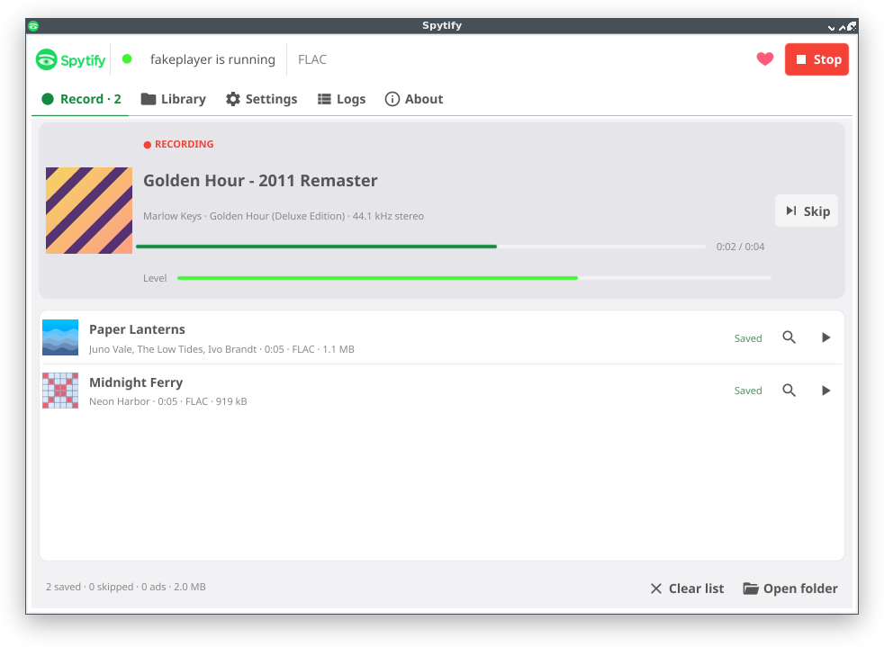

[](https://spytify.github.io/spytify/)

[](https://github.com/spytify/spytify/actions/workflows/ci.yml?query=branch%3Amaster)
[](https://github.com/spytify/spytify/actions/workflows/ci.yml?query=branch%3Amaster)
[](https://github.com/spytify/spytify/releases)
[](https://github.com/spytify/spytify/releases)
[](https://www.reddit.com/r/spytify)
[](https://spytify.github.io/spytify/donate.html)

**Records an application's audio, splits it into tracks and tags them.**



Spytify records the sound one application sends to your speakers, nothing else, and saves each track it plays as its own file: cut at the right sample, encoded with ffmpeg, and tagged with the title, artist, album and cover the application itself reports. It runs on Linux and macOS 14.2 or later; a first Windows build (Windows 10 version 2004 or later) is being tested.

This page is for people who want to build Spytify from source or contribute to it.

## How it works

```text
Spytify app ─┐                ┌── capture ◀── the application's own audio stream
spytify-cli ─┴─ JSON-RPC ──▶ spytifyd ◀── now playing ◀── the application's media interface
                                  └──▶ ffmpeg ──▶ tagged files
```

- **Two processes.** `spytifyd` does the capture, splitting, encoding and tagging, and keeps recording when no window is open. The desktop app and `spytify-cli` are clients; they speak newline-delimited JSON-RPC 2.0 to it on a local socket.
- **One application only.** Only the chosen process is recorded, so notifications or other apps never end up in a file, and no virtual audio device is needed.
  - Linux: the daemon finds the application's PipeWire stream with `pw-dump` and records it with `pw-record` (PulseAudio: `parec --monitor-stream`).
  - macOS: a small helper, `spytify-tap`, uses a Core Audio process tap.
  - Windows: `spytify-tap.exe` uses WASAPI process loopback on the application's process tree.
- **Now playing.** Title, artist, album, track number, length and cover come from the application: MPRIS on Linux, its AppleScript interface on macOS, the Windows media session (the one behind the volume flyout) on Windows. Nothing is looked up on the web.
- **Sample-accurate cuts.** A track-change notification only says roughly when a track ended. The track length gives the expected end, and the quietest 20 ms around it decides the exact sample, so a file holds one whole track and nothing of its neighbours.
- **Whole tracks only.** A track that was skipped, stopped early, or moved along its track bar is not kept, even when it played for its full length. A track already playing when you press Record is skipped too, unless you choose **Record this track from the start**.
- **Two-pass finishing.** Each track is written to a temporary WAV, checked, trimmed, loudness-normalised, encoded to `<name>.part`, tagged, then renamed. A half-written file never carries the final name.

## Requirements

- `ffmpeg` on `PATH` (or `SPYTIFY_FFMPEG`), with `libmp3lame` for MP3 output.
- Crossfade and gapless playback turned off in the recorded application: two mixed tracks cannot be separated again.
- If the application can play your own music files, keep Spytify's output folder out of the folders it scans. Otherwise it plays your recording of a track in place of the track itself.

Linux:

- PipeWire 0.3.40 or later (`pw-record`, `pw-dump`), or PulseAudio (`parec`, `pactl`).
- A D-Bus session bus, and an application that exposes MPRIS.
- On PipeWire, allow the graph to run at 44.1 kHz as well as 48 kHz, or 44.1 kHz audio is resampled before it is recorded. Create `~/.config/pipewire/pipewire.conf.d/10-rates.conf` with the content below, then run `systemctl --user restart pipewire`:

  ```text
  context.properties = {
      default.clock.allowed-rates = [ 44100 48000 ]
  }
  ```

macOS:

- macOS 14.2 or later, and an application with an AppleScript dictionary (`current track`, `player state`, `next track`).
- `spytify-tap` next to `spytifyd`; the build script puts it there.
- macOS asks once for two permissions: **System Audio Recording** for the capture, and **Automation** to read what is playing. If you denied one, turn it on in System Settings > Privacy & Security and restart Spytify.

Windows:

- Windows 10 version 2004 or later, or Windows 11.
- `spytify-tap.exe` next to `spytifyd.exe`, and Windows PowerShell, which every install has.
- The application must show what it plays in the Windows media controls.

## Legal and your account

Spytify is a general-purpose application audio recorder, like Audio Hijack, Loopback or OBS. This is not legal advice.

- Spytify downloads nothing, emulates no streaming protocol and circumvents no DRM. It records audio the operating system already plays on your speakers.
- You bring your own account for the application you record. Recording may break that service's terms, and the service can suspend or close accounts that do. Use a separate free account, not one you would mind losing.
- Private-copy rules differ from country to country. Spytify does not promise that recording is legal where you live.

**For personal use of content you are entitled to listen to. You are responsible for the terms of the services you record.**

## Build

Go 1.26 or later.

```sh
go build -o bin/ ./cmd/spytifyd ./cmd/spytify-cli ./cmd/spytify-ui   # Linux
scripts/build-macos.sh                                               # macOS: bin/Spytify.app and the command-line tools
scripts/build-windows.sh                                             # Windows, cross-compiled: bin/windows/*.exe
```

- `spytifyd` and `spytify-cli` are pure Go (`CGO_ENABLED=0` works).
- The desktop app uses [Fyne](https://fyne.io) and needs cgo:
  - Linux: `gcc`, `libgl1-mesa-dev`, `xorg-dev`, `libwayland-dev`, `libxkbcommon-dev` and `wayland-protocols` (Debian names).
  - macOS: the Xcode command line tools, which also build the Swift helper `spytify-tap`.
  - Windows: MinGW-w64 (`x86_64-w64-mingw32-gcc` and `-g++`), from Linux or macOS; it also builds the C++ helper `spytify-tap.exe`.

A build of your own records nothing until you choose the application. In the app, go to **Settings > App > Advanced > Player**, enter its process name (and its bundle id on macOS), then press **Save and restart spytifyd**. Without the app, set `SPYTIFY_TARGET_PROCESS` (see [Configuration](#configuration)).

Packagers can set a default application with the build variables `SPYTIFY_DEFAULT_PROCESS` and `SPYTIFY_DEFAULT_BUNDLE_ID`. The build scripts read them from the environment or from an untracked `build.env`; the project's CI takes them from repository variables.

The macOS app is ad-hoc signed. macOS asks for the permissions again after every rebuild, and another Mac refuses to open it until it is signed and notarised. Opened from Finder, the app still finds `ffmpeg` in `/opt/homebrew/bin` or `/usr/local/bin`.

## Desktop app

The app is a client of `spytifyd`. Closing the window does not stop a recording, and the tray menu (Start recording, Stop, Open window) keeps working while the window is hidden.

The app bar holds the Record button, which becomes Stop while recording and Stop now while the last track finishes. It also shows the application's state, the output format, Donate, and an Update button when a newer release is out.

- **Record**: the current track (cover, progress, level, Skip), then every file of the session with its status, Reveal and Play, and the session totals.
- **Library**: every audio file in the output folder, newest first, with a search box. It reads the folder again each time you open the tab.
- **Settings**: App, Output, Encoding, Recording and Ads. Each section shows the settings most people change, folds the rest under Advanced, and has a Reset button. A search box finds any setting.
- **Logs**: the startup checks, folded while they all pass, then the daemon's log, filtered by level.
- **About**: versions, the project page, the source code, Check for updates and Donate.

## Command line

```sh
bin/spytifyd &                # logs the recorded application on its first line
bin/spytify-cli info          # versions and the startup checks
bin/spytify-cli set encode.format=flac output.dir=~/Music/Recordings
bin/spytify-cli start         # recording starts with the next track
bin/spytify-cli status
bin/spytify-cli tail -f       # follow the log
bin/spytify-cli stop          # the current track finishes first; --now discards it
```

| `spytify-cli` | What it does |
| --- | --- |
| `info` | versions, recorded application, startup checks |
| `start [--single-track]` / `stop [--now]` / `status` | the recording session |
| `set key=value...` / `get [key...]` / `reset [prefix]` | settings, validated by the daemon |
| `tail [-n N] [-f]` / `events` | log lines / every event as JSON lines |
| `control play\|pause\|next\|previous\|restart` | transport; `restart` plays the current track again from 0:00 |
| `shutdown` | stops the daemon |
| `service install\|uninstall\|status` | runs `spytifyd` at login and starts it again after a crash (systemd user unit on Linux, launchd agent on macOS) |

Headless one-shot run, without a socket, until the application stops or stays idle:

```sh
bin/spytifyd --once --set output.dir=/srv/rec --set encode.format=flac
```

`spytifyd --fake testdata/timelines/basic.json` plays a scripted timeline through a built-in fake player, on any OS, to try everything without a real application.

## Configuration

The recorded application is set with environment variables, read when the daemon starts. A `.env` file next to the binary, in the working directory, or in your user configuration folder (`~/.config/spytify/.env`, or `~/Library/Application Support/spytify/.env` on macOS, which the desktop app writes) is loaded if present.

| Variable | Used for | Default |
| --- | --- | --- |
| `SPYTIFY_TARGET_PROCESS` | process to record; a comma list for several packagings | the build's default, if any |
| `SPYTIFY_TARGET_MPRIS` | D-Bus name of the application (Linux) | `org.mpris.MediaPlayer2.<process>` |
| `SPYTIFY_TARGET_BUNDLE_ID` | bundle id of the application (macOS) | the process name is used |
| `SPYTIFY_TARGET_DURATION_UNIT` | `ms` or `s`, unit of the AppleScript track length (macOS) | guessed |
| `SPYTIFY_TARGET_LAUNCH` | command that starts the application when a session starts | none |
| `SPYTIFY_TAP` | path of `spytify-tap` (macOS, Windows) | next to `spytifyd`, then `PATH` |
| `SPYTIFY_CONFIG` | settings file | `~/.config/spytify/config.toml` |
| `SPYTIFY_SOCKET` | daemon socket | `$XDG_RUNTIME_DIR/spytify.sock`; `%LOCALAPPDATA%\Spytify\spytify.sock` on Windows |
| `SPYTIFY_FFMPEG` | ffmpeg binary | `ffmpeg` on `PATH` |

Everything else is a setting in `config.toml`, changed in the app or with `spytify-cli set`; `spytify-cli get` lists them all.

Snap and Flatpak builds of an application can run under another process name and expose MPRIS only through their sandbox. List every process name in `SPYTIFY_TARGET_PROCESS`. If `spytify-cli info` finds the process but no MPRIS name, check the sandbox's D-Bus permissions (`snap connections <snap>`, `flatpak info --show-permissions <app>`).

## Protocol

Clients speak newline-delimited JSON-RPC 2.0 on the socket, and on TCP with `spytifyd --listen 127.0.0.1:7811`. Actions are requests; events are notifications sent to every client.

```json
{"jsonrpc":"2.0","id":7,"method":"settings.set","params":{"values":{"encode.format":"flac"}}}
{"jsonrpc":"2.0","id":7,"result":{"applied":["encode.format"],"rejected":{}}}
{"jsonrpc":"2.0","method":"settings.changed","params":{"values":{"encode.format":"flac"}}}
```

Go clients import `github.com/spytify/spytify/pkg/proto`. Others use [`pkg/proto/schema.json`](pkg/proto/schema.json), which lists every method and event and is generated from the same types (`go generate ./pkg/proto`).

## Tests

```sh
go test ./...    # unit tests, the fake-player scenarios, the CLI end to end
```

The scenarios in [`testdata/timelines`](testdata/timelines) drive the real core with a scripted player. They cover:

- notifications from 300 ms early to 800 ms late;
- gapless albums;
- ads;
- a sample-rate change;
- a pause;
- duplicates;
- skips;
- seeks.

Each file is compared with its source by cross-correlation: the peak must be within 2 ms of zero and the residual under −50 dBFS.

The same timelines run against real PipeWire and MPRIS through `cmd/fakeplayer`. CI does this in a container with no sound card:

```sh
. scripts/pipewire-session.sh      # D-Bus, PipeWire, WirePlumber and a null sink
go test -tags integration -v ./test/integration/
```

On macOS, the capture helper is checked against what `afplay` plays. It needs the System Audio Recording permission, so it does not run in CI:

```sh
go test -tags macos_capture -v ./test/macos/
```

## Contributing

Issues and pull requests are welcome. Run `gofmt` and `go test ./...` before you push; CI also builds every platform and runs the PipeWire scenarios.

## License

MIT, see [LICENSE](LICENSE).
